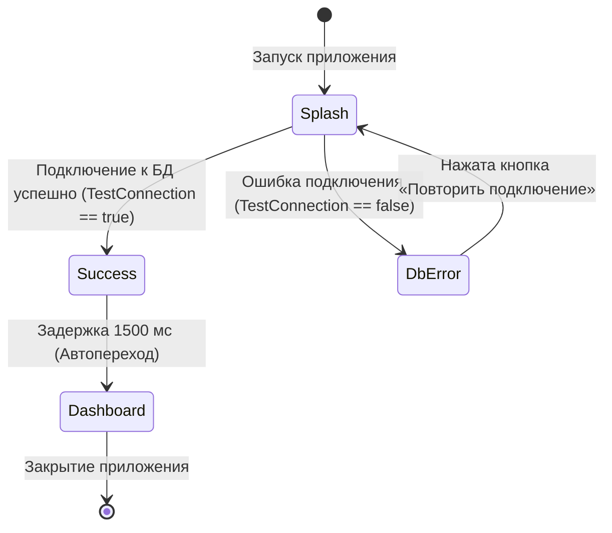
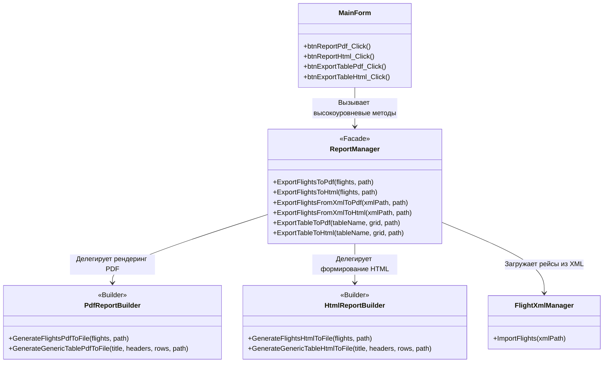
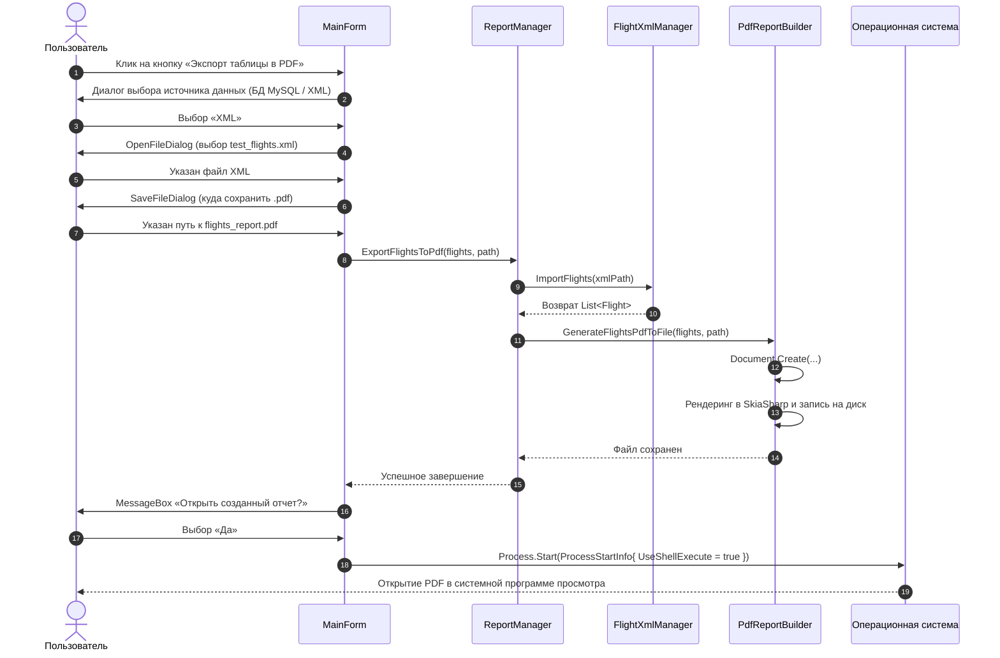

# Полная архитектурная и техническая документация проекта AirplaneManager

> **Дисциплина**: Объектно-ориентированное программирование (ООП)  
> **Организация**: СПбГЭТУ «ЛЭТИ» им. В.И. Ульянова (Ленина), факультет КТИ, кафедра ВТ  
> **Студент**: Нагаев З.С., гр. 5314  
> **Преподаватель**: Гречухин М.Н.  
> **Проект**: Информационная система управления авиакомпанией «AirplaneManager»  
> **Стек технологий**: C# 13, .NET 10.0 (Windows Forms), MySQL 8.0 / Connector, QuestPDF, LINQ to XML  

---

## Оглавление
1. [Введение и архитектурный обзор системы](#1-введение-и-архитектурный-обзор-системы)
   - [1.1. Предметная область и решаемые задачи](#11-предметная-область-и-решаемые-задачи)
   - [1.2. Архитектурные слои и ключевые паттерны](#12-архитектурные-слои-и-ключевые-паттерны)
   - [1.3. Каталог структуры папок и файлов проекта](#13-каталог-структуры-папок-и-файлов-проекта)
2. [Детальный разбор каждого файла, класса и метода](#2-детальный-разбор-каждого-файла-класса-и-метода)
   - [2.1. Точка входа приложения (`Program.cs`)](#21-точка-входа-приложения-programcs)
   - [2.2. Слой доменных моделей (`Models/`)](#22-слой-доменных-моделей-models)
   - [2.3. Пользовательские исключения (`Exceptions/`)](#23-пользовательские-исключения-exceptions)
   - [2.4. Слой доступа к данным и CRUD-менеджеры (`Managers/` и `Managers/Crud/`)](#24-слой-доступа-к-данным-и-crud-менеджеры-managers-и-managerscrud)
   - [2.5. Слой XML-сериализации (`XmlManager/`)](#25-слой-xml-сериализации-xmlmanager)
   - [2.6. Слой генерации отчетов (`Reports/`)](#26-слой-генерации-отчетов-reports)
   - [2.7. Слой пользовательского интерфейса (`UI/` и `MainForm`)](#27-слой-пользовательского-интерфейса-ui-и-mainform)
3. [Графический интерфейс: полная карта элементов управления и событий](#3-графический-интерфейс-полная-карта-элементов-управления-и-событий)
   - [3.1. Жизненный цикл формы и динамические экраны](#31-жизненный-цикл-формы-и-динамические-экраны)
   - [3.2. Боковая панель навигации (Sidebar)](#32-боковая-панель-навигации-sidebar)
   - [3.3. Экран выбора действий сущности (Entity Choice)](#33-экран-выбора-действий-сущности-entity-choice)
   - [3.4. Экран табличного представления (Table View) и реактивный поиск](#34-экран-табличного-представления-table-view-и-реактивный-поиск)
   - [3.5. Модальный редактор сущностей (`EntityEditForm`)](#35-модальный-редактор-сущностей-entityeditform)
   - [3.6. Модальное окно множественного выбора (`MultiSelectDialog`)](#36-модальное-окно-множественного-выбора-multiselectdialog)
   - [3.7. Сводная таблица соответствия «Элемент UI — Файл — Обработчик — Назначение»](#37-сводная-таблица-соответствия-элемент-ui--файл--обработчик--назначение)
4. [Исчерпывающее руководство по Лабораторной работе № 7](#4-исчерпывающее-руководство-по-лабораторной-работе--7)
   - [4.1. Цели, требования и академический регламент лабораторной работы](#41-цели-требования-и-академический-регламент-лабораторной-работы)
   - [4.2. Сравнение подходов: JasperReports (Java) против QuestPDF (.NET C#)](#42-сравнение-подходов-jasperreports-java-против-questpdf-net-c)
   - [4.3. Архитектура генератора отчетов: паттерн Фасад (`ReportManager`)](#43-архитектура-генератора-отчетов-паттерн-фасад-reportmanager)
   - [4.4. Реализация Шаблона № 1 (PDF) на базе Fluent API QuestPDF](#44-реализация-шаблона--1-pdf-на-базе-fluent-api-questpdf)
   - [4.5. Реализация Шаблона № 2 (HTML) с правилами `@media print`](#45-реализация-шаблона--2-html-с-правилами-media-print)
   - [4.6. Отчет по отдельной таблице базы данных (сущность `Airplane`)](#46-отчет-по-отдельной-таблице-базы-данных-сущность-airplane)
   - [4.7. Сквозной конвейер: «XML-файл → Десериализация → PDF/HTML → Просмотр»](#47-сквозной-конвейер-xml-файл--десериализация--pdfhtml--просмотр)
5. [Инструкция по сборке, запуску и проверке](#5-инструкция-по-сборке-запуску-и-проверке)

---

## 1. Введение и архитектурный обзор системы

### 1.1. Предметная область и решаемые задачи
Информационная система **AirplaneManager** предназначена для автоматизации операционной деятельности авиакомпании. Предметная область охватывает учет и координацию ключевых объектов авиационного предприятия:
- **Воздушный флот (Airplanes)**: учет бортов, моделей самолетов и их максимальной пассажировместимости.
- **География полетов (Airports)**: реестр аэропортов мира с указанием международных кодов IATA, названий, городов и стран.
- **Маршрутная сеть (Routes)**: перелеты между аэропортами отправления и прибытия с расчетом плановой продолжительности в часах.
- **Летный состав (Pilots)**: пилоты с квалификационными характеристиками (налет в часах, номер летного свидетельства, класс/ранг допуска).
- **Обслуживающий персонал (FlightAttendants)**: бортпроводники с квалификационными категориями обслуживания и владением иностранными языками.
- **Клиентская база (Passengers)**: пассажиры с паспортными данными и накопленными милями по программе лояльности.
- **Рейсы (Flights)**: связующая сущность расписания, объединяющая дату и время вылета, конкретный маршрут, назначенный самолет, прикрепленный экипаж (команду пилотов и бортпроводников) и зарегистрированных пассажиров.

### 1.2. Архитектурные слои и ключевые паттерны
Приложение построено в соответствии с принципами слоистой архитектуры (N-Tier Architecture) и Clean Code:

```
[ UI Layer (WinForms, DoubleBuffered Views, Modals) ]
                      │
                      ▼
[ Business & Report Layer (ReportManager, FlightXmlManager, AirplaneManagerClass) ]
                      │
         ┌────────────┴────────────┐
         ▼                         ▼
[ CRUD / Data Access ]      [ External Generators ]
(DatabaseHelper, CrudMgrs)  (QuestPDF Fluent, HTML5)
         │                         │
         ▼                         ▼
 [ MySQL Database ]         [ PDF / HTML Files ]
```

1. **Слой представления (Presentation / UI Layer)**:
   - Разделение ответственности через механизм частичных классов (`partial class`): файл [MainForm.Layout.cs](file:///c:/Users/scpgg/Documents/LETI/OOP/repos/AirplaneManager/AirplaneManager/UI/MainForm.Layout.cs) отвечает исключительно за декларативное построение и верстку интерфейса, а файл [MainForm.cs](file:///c:/Users/scpgg/Documents/LETI/OOP/repos/AirplaneManager/AirplaneManager/MainForm.cs) — за жизненный цикл, логику событий и управление состоянием.
   - Использование специализированных буферизованных контейнеров (`BufferedPanel`, `BufferedTableLayoutPanel`) и стиля окна `WS_EX_COMPOSITED` для полного устранения мерцания (flickering) графики при ресайзе и динамической смене панелей.
2. **Слой доменных моделей (Domain Models)**:
   - Иерархия наследования: базовый класс [Person.cs](file:///c:/Users/scpgg/Documents/LETI/OOP/repos/AirplaneManager/AirplaneManager/Models/Person.cs) инкапсулирует общие персональные данные и наследуется классами [Pilot.cs](file:///c:/Users/scpgg/Documents/LETI/OOP/repos/AirplaneManager/AirplaneManager/Models/Pilot.cs), [FlightAttendant.cs](file:///c:/Users/scpgg/Documents/LETI/OOP/repos/AirplaneManager/AirplaneManager/Models/FlightAttendant.cs) и [Passenger.cs](file:///c:/Users/scpgg/Documents/LETI/OOP/repos/AirplaneManager/AirplaneManager/Models/Passenger.cs).
   - Агрегация и композиция: класс [Flight.cs](file:///c:/Users/scpgg/Documents/LETI/OOP/repos/AirplaneManager/AirplaneManager/Models/Flight.cs) объединяет [Route.cs](file:///c:/Users/scpgg/Documents/LETI/OOP/repos/AirplaneManager/AirplaneManager/Models/Route.cs), [Airplane.cs](file:///c:/Users/scpgg/Documents/LETI/OOP/repos/AirplaneManager/AirplaneManager/Models/Airplane.cs) и коллекции людей.
3. **Слой доступа к данным (Data Access Layer / CRUD)**:
   - Паттерн *Table Data Gateway / Data Mapper*: статические менеджеры сущностей (`*CrudManager.cs`) изолируют SQL-запросы (`INSERT`, `SELECT`, `UPDATE`, `DELETE`) и транзакционную логику связующих таблиц типа Many-to-Many (`flight_pilots`, `flight_flight_attendants`, `flight_passengers`).
   - Централизованный поставщик соединений [DatabaseHelper.cs](file:///c:/Users/scpgg/Documents/LETI/OOP/repos/AirplaneManager/AirplaneManager/Managers/DatabaseHelper.cs) с безопасным высвобождением ресурсов через конструкцию `using`.
4. **Слой сериализации и интеграции (XmlManager)**:
   - Двунаправленный обмен данными с XML на основе технологии **LINQ to XML** ([FlightXmlManager.cs](file:///c:/Users/scpgg/Documents/LETI/OOP/repos/AirplaneManager/AirplaneManager/XmlManager/FlightXmlManager.cs)): экспорт древовидной структуры рейсов, валидный парсинг с автоприведением типов, сохранение напрямую в реляционную базу данных.
5. **Слой генерации отчетов (Reports Layer) — Лабораторная работа № 7**:
   - Паттерн **Фасад (Facade)**: статический класс [ReportManager.cs](file:///c:/Users/scpgg/Documents/LETI/OOP/repos/AirplaneManager/AirplaneManager/Reports/ReportManager.cs) скрывает сложность генераторов и предоставляет единые методы построения отчетов как из базы данных, так и из XML-файлов или компонентов `DataGridView`.
   - Паттерн **Строитель (Builder)**: классы [PdfReportBuilder.cs](file:///c:/Users/scpgg/Documents/LETI/OOP/repos/AirplaneManager/AirplaneManager/Reports/PdfReportBuilder.cs) (на базе движка QuestPDF) и [HtmlReportBuilder.cs](file:///c:/Users/scpgg/Documents/LETI/OOP/repos/AirplaneManager/AirplaneManager/Reports/HtmlReportBuilder.cs) инкапсулируют форматирование документов, расчет табличных колонок и наложение стилей.

### 1.3. Каталог структуры папок и файлов проекта
```
AirplaneManager/
├── AirplaneManager.sln                     # Файл решения Visual Studio / dotnet CLI
└── AirplaneManager/
    ├── AirplaneManager.csproj              # Проектный файл C# (.NET 10.0-windows, зависимости NuGet)
    ├── Program.cs                          # Точка входа в приложение и CLI-обработчик отчетов
    ├── MainForm.cs                         # Бизнес-логика главной формы (обработчики событий, фильтрация)
    ├── Exceptions/                         # Доменные исключения бизнес-логики
    │   ├── FlightCapacityExceededException.cs  # Ошибка переполнения вместимости борта
    │   └── InvalidRouteException.cs            # Ошибка совпадения пунктов вылета и посадки
    ├── Managers/                           # Инфраструктура доступа к данным
    │   ├── DatabaseHelper.cs               # Строка подключения и фабрика соединений MySqlConnection
    │   ├── EntityType.cs                   # Перечисление типов сущностей предметной области
    │   ├── AirplaneManagerClass.cs         # Контейнер списков сущностей в оперативной памяти
    │   └── Crud/                           # Менеджеры CRUD-операций для работы с таблицами MySQL
    │       ├── AirplaneCrudManager.cs      # CRUD для самолетов (airplanes)
    │       ├── AirportCrudManager.cs       # CRUD для аэропортов (airports)
    │       ├── FlightAttendantCrudManager.cs # CRUD для бортпроводников (flight_attendants)
    │       ├── FlightCrudManager.cs        # CRUD для рейсов со связующими таблицами (flights)
    │       ├── PassengerCrudManager.cs     # CRUD для пассажиров (passengers)
    │       ├── PilotCrudManager.cs         # CRUD для пилотов (pilots)
    │       └── RouteCrudManager.cs         # CRUD для маршрутов (routes)
    ├── Models/                             # Классы сущностей предметной области
    │   ├── Person.cs                       # Базовый абстрактный класс человека
    │   ├── Pilot.cs                        # Модель пилота
    │   ├── FlightAttendant.cs              # Модель бортпроводника
    │   ├── Passenger.cs                    # Модель пассажира
    │   ├── Airplane.cs                     # Модель воздушного судна
    │   ├── Airport.cs                      # Модель аэропорта
    │   ├── Route.cs                        # Модель маршрута перелета
    │   └── Flight.cs                       # Модель рейса (агрегат)
    ├── Reports/                            # Модуль генерации отчетов (Лабораторная работа № 7)
    │   ├── ReportManager.cs                # Фасад формирования отчетов (PDF, HTML, Grid, XML)
    │   ├── PdfReportBuilder.cs             # Построитель PDF на базе библиотеки QuestPDF
    │   └── HtmlReportBuilder.cs            # Построитель адаптивных HTML-отчетов
    ├── UI/                                 # Компоненты графического интерфейса
    │   ├── MainForm.Layout.cs              # Верстка главной формы, панели, стилизация
    │   ├── EntityEditForm.cs               # Универсальный модальный диалог создания/редактирования
    │   ├── MultiSelectDialog.cs            # Диалог множественного выбора членов экипажа и пассажиров
    │   └── UiStyleHelper.cs                # Хелпер стилизации, цветов, шрифтов и двойной буферизации
    └── XmlManager/                         # Модуль XML-сериализации (Лабораторная работа № 6)
        └── FlightXmlManager.cs             # Экспорт и импорт рейсов через LINQ to XML
```

---

## 2. Детальный разбор каждого файла, класса и метода

### 2.1. Точка входа приложения (`Program.cs`)
- **Файл**: [Program.cs](file:///c:/Users/scpgg/Documents/LETI/OOP/repos/AirplaneManager/AirplaneManager/Program.cs)
- **Пространство имен**: `AirplaneManager`
- **Класс**: `internal static class Program`

#### Назначение
Главная точка входа исполняемого файла приложения. Обеспечивает инициализацию среды Windows Forms, запуск цикла обработки сообщений окна (`Application.Run`), а также предоставляет встроенный консольный интерфейс пакетного тестирования генерации отчетов по аргументу командной строки.

#### Методы
1. `static void Main(string[] args)`
   - **Сигнатура**: `[STAThread] static void Main(string[] args)`
   - **Параметры**: `args` — строковый массив параметров запуска.
   - **Логика**:
     - Если передан аргумент `--generate-test-reports`, управление передается методу `GenerateTestReports()`, после чего приложение завершает работу без вывода GUI.
     - При стандартном запуске вызываются методы `Application.EnableVisualStyles()` и `Application.SetCompatibleTextRenderingDefault(false)`, после чего создается и отображается экземпляр главной формы `new MainForm()`.
2. `private static void GenerateTestReports()`
   - **Сигнатура**: `private static void GenerateTestReports()`
   - **Логика работы**:
     - Находит файл данных `test_flights.xml`.
     - Вызывает десериализацию рейсов через `FlightXmlManager.ImportFlights(xmlPath)`.
     - Генерирует отчет Шаблона № 1 в формате PDF через `ReportManager.ExportFlightsToPdf(...)`.
     - Генерирует превью страниц PDF в PNG-изображения через `PdfReportBuilder.GenerateFlightsPdfImages(...)`.
     - Генерирует отчет Шаблона № 2 в формате HTML через `ReportManager.ExportFlightsToHtml(...)`.
     - Генерирует табличный отчет по флоту самолетов (`airplanes`) в форматах PDF и HTML.
     - Создает скрытое окно `MainForm`, отображает его за границами виртуального экрана (`-2000, -2000`), наполняет данными и с помощью метода `DrawToBitmap` делает превью графического интерфейса.

---

### 2.2. Слой доменных моделей (`Models/`)

#### `Person.cs`
- **Файл**: [Person.cs](file:///c:/Users/scpgg/Documents/LETI/OOP/repos/AirplaneManager/AirplaneManager/Models/Person.cs)
- **Класс**: `public abstract class Person`
- **Назначение**: Базовая модель человека в предметной области авиакомпании. Инкапсулирует идентификатор, фамилию, имя, возраст и паспортные данные.
- **Свойства**:
  - `public int Id { get; set; }` — уникальный идентификатор записи.
  - `public string FirstName { get; set; }` — имя.
  - `public string LastName { get; set; }` — фамилия.
  - `public int Age { get; set; }` — возраст (в годах).
  - `public string Passport { get; set; }` — серия и номер паспорта.
- **Конструкторы**:
  - `public Person(string firstName, string lastName, int age, string passport)` — конструктор для новых сущностей (без `Id`).
  - `public Person(int id, string firstName, string lastName, int age, string passport)` — конструктор полной инициализации из базы данных.
- **Методы**:
  - `public override string ToString()` — возвращает строковое представление в формате `"{LastName} {FirstName} (Паспорт: {Passport})"`.

#### `Pilot.cs`
- **Файл**: [Pilot.cs](file:///c:/Users/scpgg/Documents/LETI/OOP/repos/AirplaneManager/AirplaneManager/Models/Pilot.cs)
- **Класс**: `public class Pilot : Person`
- **Назначение**: Модель пилота авиакомпании. Наследует свойства класса `Person` и расширяет их профессиональными характеристиками.
- **Свойства**:
  - `public int FlightHours { get; set; }` — суммарный налет в часах.
  - `public int LicenseNumber { get; set; }` — номер летного свидетельства.
  - `public int Rang { get; set; }` — класс допуска/ранг (1 — командир воздушного судна КВС, 2 — второй пилот).
- **Конструкторы**:
  - `public Pilot(string firstName, string lastName, int age, string passport, int flightHours, int licenseNumber, int rang) : base(...)` — создание нового пилота.
  - `public Pilot(int id, string firstName, string lastName, int age, string passport, int flightHours, int licenseNumber, int rang) : base(id, ...)` — загрузка пилота из БД.

#### `FlightAttendant.cs`
- **Файл**: [FlightAttendant.cs](file:///c:/Users/scpgg/Documents/LETI/OOP/repos/AirplaneManager/AirplaneManager/Models/FlightAttendant.cs)
- **Класс**: `public class FlightAttendant : Person`
- **Назначение**: Модель бортпроводника (стюарда/стюардессы).
- **Свойства**:
  - `public int Service { get; set; }` — уровень сервисного обслуживания / категория (1 — эконом, 2 — бизнес/первый класс).
  - `public List<string> Languages { get; set; }` — список языков, которыми владеет бортпроводник.
- **Конструкторы**:
  - `public FlightAttendant(string firstName, string lastName, int age, string passport, int service, List<string>? languages = null) : base(...)`
  - `public FlightAttendant(int id, string firstName, string lastName, int age, string passport, int service, List<string>? languages = null) : base(id, ...)`

#### `Passenger.cs`
- **Файл**: [Passenger.cs](file:///c:/Users/scpgg/Documents/LETI/OOP/repos/AirplaneManager/AirplaneManager/Models/Passenger.cs)
- **Класс**: `public class Passenger : Person`
- **Назначение**: Модель клиента авиакомпании (пассажира).
- **Свойства**:
  - `public int Bonus { get; set; }` — количество бонусных миль на счете программы лояльности.
- **Конструкторы**:
  - `public Passenger(string firstName, string lastName, int age, string passport, int bonus) : base(...)`
  - `public Passenger(int id, string firstName, string lastName, int age, string passport, int bonus) : base(id, ...)`

#### `Airplane.cs`
- **Файл**: [Airplane.cs](file:///c:/Users/scpgg/Documents/LETI/OOP/repos/AirplaneManager/AirplaneManager/Models/Airplane.cs)
- **Класс**: `public class Airplane`
- **Назначение**: Модель воздушного судна.
- **Свойства**:
  - `public int Id { get; set; }` — первичный ключ в таблице `airplanes`.
  - `public string Model { get; set; }` — наименование модели судна (например, "Boeing 737-800", "Airbus A320").
  - `public int Capacity { get; set; }` — пассажировместимость (максимальное число кресел).
- **Конструкторы**:
  - `public Airplane(string model, int capacity)`
  - `public Airplane(int id, string model, int capacity)`

#### `Airport.cs`
- **Файл**: [Airport.cs](file:///c:/Users/scpgg/Documents/LETI/OOP/repos/AirplaneManager/AirplaneManager/Models/Airport.cs)
- **Класс**: `public class Airport`
- **Назначение**: Модель аэропорта.
- **Свойства**:
  - `public int Id { get; set; }` — первичный ключ в таблице `airports`.
  - `public string Name { get; set; }` — наименование аэропорта (например, "Пулково", "Шереметьево").
  - `public string Code { get; set; }` — трехбуквенный международный код IATA (например, "LED", "SVO").
  - `public string City { get; set; }` — город базирования.
  - `public string Country { get; set; }` — страна расположения.
- **Конструкторы**:
  - `public Airport(string name, string code, string city, string country)`
  - `public Airport(int id, string name, string code, string city, string country)`

#### `Route.cs`
- **Файл**: [Route.cs](file:///c:/Users/scpgg/Documents/LETI/OOP/repos/AirplaneManager/AirplaneManager/Models/Route.cs)
- **Класс**: `public class Route`
- **Назначение**: Модель регулярного маршрута перелета.
- **Свойства**:
  - `public int Id { get; set; }` — первичный ключ в таблице `routes`.
  - `public string RouteNumber { get; set; }` — номер рейса/маршрута (например, "SU-1002").
  - `public double FlightDurationHours { get; set; }` — плановая длительность полета в часах.
  - `public Airport DepartureAirport { get; set; }` — объект аэропорта отправления.
  - `public Airport ArrivalAirport { get; set; }` — объект аэропорта прибытия.
- **Конструкторы**:
  - `public Route(string routeNumber, double flightDurationHours, Airport departureAirport, Airport arrivalAirport)`
  - `public Route(int id, string routeNumber, double flightDurationHours, Airport departureAirport, Airport arrivalAirport)`

#### `Flight.cs`
- **Файл**: [Flight.cs](file:///c:/Users/scpgg/Documents/LETI/OOP/repos/AirplaneManager/AirplaneManager/Models/Flight.cs)
- **Класс**: `public class Flight`
- **Назначение**: Главный агрегат предметной области, объединяющий все аспекты конкретного рейса.
- **Свойства**:
  - `public int Id { get; set; }` — первичный ключ в таблице `flights`.
  - `public DateTime FlightDate { get; set; }` — дата и время вылета.
  - `public Route Route { get; set; }` — маршрут рейса.
  - `public Airplane? Airplane { get; set; }` — назначенное воздушное судно (может быть `null`, если судно еще не назначено).
  - `public List<Passenger> Passengers { get; set; }` — зарегистрированные пассажиры рейса.
  - `public List<Pilot> Pilots { get; set; }` — назначенный экипаж пилотов.
  - `public List<FlightAttendant> FlightAttendants { get; set; }` — назначенная бригада бортпроводников.
- **Конструкторы**:
  - `public Flight(DateTime flightDate, Route route, Airplane? airplane = null, List<Passenger>? passengers = null, List<Pilot>? pilots = null, List<FlightAttendant>? attendants = null)`
  - `public Flight(int id, DateTime flightDate, Route route, Airplane? airplane = null, List<Passenger>? passengers = null, List<Pilot>? pilots = null, List<FlightAttendant>? attendants = null)`

---

### 2.3. Пользовательские исключения (`Exceptions/`)

#### `FlightCapacityExceededException.cs`
- **Файл**: [FlightCapacityExceededException.cs](file:///c:/Users/scpgg/Documents/LETI/OOP/repos/AirplaneManager/AirplaneManager/Exceptions/FlightCapacityExceededException.cs)
- **Класс**: `public class FlightCapacityExceededException : Exception`
- **Назначение**: Выбрасывается бизнес-логикой, когда количество назначенных на рейс пассажиров превышает установленную вместимость воздушного судна (`passengers.Count > airplane.Capacity`).
- **Свойства**:
  - `public int Capacity { get; }` — вместимость самолета.
  - `public int PassengerCount { get; }` — фактически выбранное количество пассажиров.
- **Конструктор**:
  - `public FlightCapacityExceededException(int capacity, int passengerCount) : base($"Вместимость самолета ({capacity} мест) превышена: выбрано {passengerCount} пассажиров.")`

#### `InvalidRouteException.cs`
- **Файл**: [InvalidRouteException.cs](file:///c:/Users/scpgg/Documents/LETI/OOP/repos/AirplaneManager/AirplaneManager/Exceptions/InvalidRouteException.cs)
- **Класс**: `public class InvalidRouteException : Exception`
- **Назначение**: Выбрасывается при попытке создать или отредактировать маршрут, в котором аэропорт отправления совпадает с аэропортом прибытия.
- **Свойства**:
  - `public string? DepartureAirport { get; }` — название/код пункта вылета.
  - `public string? ArrivalAirport { get; }` — название/код пункта прилета.
- **Конструктор**:
  - `public InvalidRouteException(string departureAirport, string arrivalAirport) : base($"Некорректный маршрут: пункт вылета '{departureAirport}' совпадает с пунктом назначения '{arrivalAirport}'.")`

---

### 2.4. Слой доступа к данным и CRUD-менеджеры (`Managers/` и `Managers/Crud/`)

#### `DatabaseHelper.cs`
- **Файл**: [DatabaseHelper.cs](file:///c:/Users/scpgg/Documents/LETI/OOP/repos/AirplaneManager/AirplaneManager/Managers/DatabaseHelper.cs)
- **Класс**: `public static class DatabaseHelper`
- **Назначение**: Централизованное управление подключением к СУБД MySQL.
- **Поля**:
  - `private static string _connectionString` — строка подключения к серверу `localhost`, базе данных `db_airplanemanager`, пользователю `root`.
- **Методы**:
  - `public static MySqlConnection GetConnection()` — создает и возвращает новый закрытый экземпляр `MySqlConnection` с заданной строкой подключения.
  - `public static bool TestConnection()` — открывает тестовое соединение в блоке `try/catch`. Возвращает `true`, если соединение успешно установлено, и `false` при недоступности сервера СУБД.

#### `EntityType.cs`
- **Файл**: `AirplaneManager/Managers/EntityType.cs`
- **Тип**: `public enum EntityType`
- **Элементы**: `Route`, `Flight`, `Airport`, `Pilot`, `Airplane`, `FlightAttendant`, `Passenger`.
- **Назначение**: Строго типизированный маркер текущей выбранной сущности в системе, используемый для маршрутизации табличных представлений, редактирования и CRUD-операций.

#### `AirplaneManagerClass.cs`
- **Файл**: [AirplaneManagerClass.cs](file:///c:/Users/scpgg/Documents/LETI/OOP/repos/AirplaneManager/AirplaneManager/Managers/AirplaneManagerClass.cs)
- **Класс**: `internal class AirplaneManagerClass`
- **Назначение**: Внутрипамятный агрегатор коллекций объектов (in-memory storage), применявшийся на этапах лабораторных работ до внедрения реляционной базы данных. Содержит списки сущностей и вспомогательные методы добавления объектов (`AddAirport`, `AddAirplane`, `AddRoute`, `AddPilot`, `AddFlightAttendant`, `AddPassenger`, `AddFlight`).

#### Группа классов `*CrudManager.cs` в папке `Managers/Crud/`
Каждый класс группы реализует шаблон *Table Data Gateway* для соответствующей таблицы базы данных MySQL:
1. [AirplaneCrudManager.cs](file:///c:/Users/scpgg/Documents/LETI/OOP/repos/AirplaneManager/AirplaneManager/Managers/Crud/AirplaneCrudManager.cs) (таблица `airplanes`):
   - `Add(Airplane airplane)`: `INSERT INTO airplanes (model, capacity) VALUES (@model, @capacity)`.
   - `GetAll()`: `SELECT id, model, capacity FROM airplanes`.
   - `GetById(int id)`: возвращает самолет по ID.
   - `Update(Airplane airplane)`: `UPDATE airplanes SET model = @model, capacity = @capacity WHERE id = @id`.
   - `Delete(int id)`: `DELETE FROM airplanes WHERE id = @id`.
2. [AirportCrudManager.cs](file:///c:/Users/scpgg/Documents/LETI/OOP/repos/AirplaneManager/AirplaneManager/Managers/Crud/AirportCrudManager.cs) (таблица `airports`):
   - Методы: `Add(Airport airport)`, `GetAll()`, `GetById(int id)`, `Update(Airport airport)`, `Delete(int id)`.
3. [FlightAttendantCrudManager.cs](file:///c:/Users/scpgg/Documents/LETI/OOP/repos/AirplaneManager/AirplaneManager/Managers/Crud/FlightAttendantCrudManager.cs) (таблица `flight_attendants`):
   - Методы: `Add`, `GetAll`, `GetById`, `Update`, `Delete`.
4. [PassengerCrudManager.cs](file:///c:/Users/scpgg/Documents/LETI/OOP/repos/AirplaneManager/AirplaneManager/Managers/Crud/PassengerCrudManager.cs) (таблица `passengers`):
   - Методы: `Add`, `GetAll`, `GetById`, `Update`, `Delete`.
5. [PilotCrudManager.cs](file:///c:/Users/scpgg/Documents/LETI/OOP/repos/AirplaneManager/AirplaneManager/Managers/Crud/PilotCrudManager.cs) (таблица `pilots`):
   - Методы: `Add`, `GetAll`, `GetById`, `Update`, `Delete`.
6. [RouteCrudManager.cs](file:///c:/Users/scpgg/Documents/LETI/OOP/repos/AirplaneManager/AirplaneManager/Managers/Crud/RouteCrudManager.cs) (таблица `routes`):
   - Выполняет сложные SQL-соединения `JOIN airports dep` и `JOIN airports arr` для гидратации связанных объектов аэропортов вылета и прилета.
7. [FlightCrudManager.cs](file:///c:/Users/scpgg/Documents/LETI/OOP/repos/AirplaneManager/AirplaneManager/Managers/Crud/FlightCrudManager.cs) (таблица `flights` и связующие таблицы):
   - `Add(Flight flight, List<int> pilotIds, List<int> attendantIds)`:
     - Вставляет запись рейса в таблицу `flights`.
     - Получает сгенерированный первичный ключ через `SELECT LAST_INSERT_ID()`.
     - Пакетно вставляет связи в таблицы `flight_passengers`, `flight_pilots` и `flight_flight_attendants`.
   - `GetAll()`:
     - Выполняет комплексный SQL-запрос с множественными соединениями `JOIN` и `LEFT JOIN` к таблицам `routes`, `airports`, `airplanes`, `flight_passengers`, `flight_pilots`, `flight_flight_attendants`.
     - С помощью структуры `Dictionary<int, Flight>` группирует строки результирующего набора и гидратирует вложенные коллекции пассажиров, пилотов и стюардесс без дублирования рейсов.
   - `Update(Flight flight, List<int> pilotIds, List<int> attendantIds)`:
     - Обновляет базовую информацию в таблице `flights`.
     - Удаляет старые связи из промежуточных таблиц и записывает актуальный набор связей.
   - `Delete(int flightId)`:
     - Каскадно удаляет связанные записи из `flight_passengers`, `flight_pilots`, `flight_flight_attendants`, затем удаляет сам рейс из `flights`.

---

### 2.5. Слой XML-сериализации (`XmlManager/`)
- **Файл**: [FlightXmlManager.cs](file:///c:/Users/scpgg/Documents/LETI/OOP/repos/AirplaneManager/AirplaneManager/XmlManager/FlightXmlManager.cs)
- **Класс**: `public static class FlightXmlManager`

#### Назначение
Реализация требований Лабораторной работы № 6: экспорт и импорт древовидной структуры рейсов авиакомпании в формате XML с использованием библиотеки `System.Xml.Linq` (LINQ to XML).

#### Методы
1. `public static void ExportFlights(string filePath, List<Flight> flights)`
   - Формирует корневой элемент `<flights>`.
   - Для каждого рейса генерирует узел `<flight id="..." date="...">` с вложенными поддеревьями:
     - `<route id="..." number="..." duration="...">` с дочерними элементами `<departure>` и `<arrival>`.
     - `<airplane id="..." model="..." capacity="...">`.
     - `<pilots>` с элементами `<pilot id="..." firstName="..." lastName="..." ... />`.
     - `<flightAttendants>` с элементами `<attendant ... />`.
     - `<passengers>` с элементами `<passenger ... />`.
   - Сохраняет документ с декларацией `<?xml version="1.0" encoding="utf-8" standalone="yes"?>` по указанному пути `filePath`.
2. `public static List<Flight> ImportFlights(string filePath)`
   - Проверяет существование файла через `File.Exists`. При отсутствии бросает исключение `FileNotFoundException`.
   - Загружает документ через `XDocument.Load(filePath)`.
   - Использует безопасный синтаксис приведения атрибутов (например, `(int?)pNode.Attribute("id") ?? 0`) для исключения исключений `NullReferenceException` при чтении поврежденных XML-файлов.
   - Возвращает строго типизированный список `List<Flight>`.
3. `public static int ImportFlightsToDatabase(string filePath, bool clearExisting = false)`
   - Выполняет интеллектуальное слияние данных из XML с существующими справочниками базы данных MySQL.
   - Загружает рейсы из файла с помощью `ImportFlights`.
   - При `clearExisting == true` очищает таблицы рейсов и связей.
   - Для каждого рейса сопоставляет маршрут и самолет по ID или текстовому совпадению (номеру рейса / модели самолета).
   - Сопоставляет пилотов, бортпроводников и пассажиров по номерам удостоверений, паспортам или ФИО.
   - Сохраняет нормализованные записи в базу данных через `FlightCrudManager.Add`. Возвращает число успешно импортированных рейсов.

---

### 2.6. Слой генерации отчетов (`Reports/`)
Подробный теоретический и технический разбор данного слоя представлен в [Разделе 4](#4-исчерпывающее-руководство-по-лабораторной-работе--7).
- [ReportManager.cs](file:///c:/Users/scpgg/Documents/LETI/OOP/repos/AirplaneManager/AirplaneManager/Reports/ReportManager.cs): Статический фасад генерации отчетов. Предоставляет методы `ExportFlightsToPdf`, `ExportFlightsToHtml`, `ExportFlightsFromXmlToPdf`, `ExportFlightsFromXmlToHtml`, `ExportTableToPdf`, `ExportTableToHtml`.
- [PdfReportBuilder.cs](file:///c:/Users/scpgg/Documents/LETI/OOP/repos/AirplaneManager/AirplaneManager/Reports/PdfReportBuilder.cs): Генератор PDF-документов на базе библиотеки QuestPDF.
- [HtmlReportBuilder.cs](file:///c:/Users/scpgg/Documents/LETI/OOP/repos/AirplaneManager/AirplaneManager/Reports/HtmlReportBuilder.cs): Генератор отчетов в формате HTML5 со строгим оформлением и стилями для печати.

---

### 2.7. Слой пользовательского интерфейса (`UI/` и `MainForm`)

#### `UiStyleHelper.cs`
- **Файл**: [UiStyleHelper.cs](file:///c:/Users/scpgg/Documents/LETI/OOP/repos/AirplaneManager/AirplaneManager/UI/UiStyleHelper.cs)
- **Класс**: `public static class UiStyleHelper`
- **Назначение**: Централизованная палитра цветов и фабричные методы создания единообразных компонентов.
- **Константы цветов**:
  - `SidebarBgColor`: полупрозрачный серый фон боковой панели `ARGB(180, 240, 240, 240)`.
  - `HeaderBgColor`: фон верхнего колонтитула `ARGB(180, 245, 245, 245)`.
  - `BottomBarBgColor`: фон нижней панели действий `ARGB(210, 230, 230, 230)`.
  - `SidebarBtnDefault`: стандартное состояние кнопки бокового меню `RGB(215, 215, 215)`.
  - `SidebarBtnActive`: активное состояние выбранной кнопки меню `RGB(50, 50, 50)` (темный акцент с белым текстом).
  - `ActionBtnBg`: фон кнопок действий `RGB(200, 190, 190)`.
- **Вспомогательные классы**:
  - `BufferedPanel : Panel`: специализированная панель с включенной двойной буферизацией и стилями `AllPaintingInWmPaint`, `OptimizedDoubleBuffer`.
  - `BufferedTableLayoutPanel : TableLayoutPanel`: табличный контейнер с аппаратной буферизацией для предотвращения артефактов отрисовки при динамической компоновке.

#### `MainForm.Layout.cs`
- **Файл**: [MainForm.Layout.cs](file:///c:/Users/scpgg/Documents/LETI/OOP/repos/AirplaneManager/AirplaneManager/UI/MainForm.Layout.cs)
- **Класс**: `public partial class MainForm`
- **Назначение**: Полная верстка элементов интерфейса главной формы.
- **Метод**: `private void BuildUiElements()`:
  - Настраивает базовые параметры окна: размер `1280x720`, минимальный размер `960x600`, заголовок `"AirplaneManager — Управление авиакомпанией"`, фоновое изображение `Background.png`.
  - Формирует 4 корневых экранных слоя (`AppView`):
    1. `pnlSplash`: стартовый экран заставки с логотипом и анимацией загрузки (`lblLoadingDots`).
    2. `pnlDbError`: карточка ошибки подключения к СУБД с инструкцией и кнопкой повторной попытки.
    3. `pnlSuccess`: экран успешной инициализации соединения с базой данных.
    4. `pnlDashboard`: главный рабочий интерфейс приложения (боковое меню, верхний хедер, рабочая область).
  - Внутри панели `pnlDashboard` конструирует:
    - Боковую навигационную панель с 8 кнопками (`btnRoutes`, `btnFlights`, `btnAirports`, `btnPilots`, `btnAirplanes`, `btnAttendants`, `btnPassengers`, `btnSettings`).
    - Верхний заголовок (`lblDashTitle`), кнопку возврата (`btnBackHeader`) и строку поиска (`txtSearch`).
    - Центральную панель выбора режима (`pnlEntityChoice`) с кнопками «Добавить новую запись», «Просмотреть таблицу», а для рейсов — кнопками XML-обмена (`btnExportXml`, `btnImportXml`).
    - Панель табличного представления (`pnlEntityTableContainer`) с компонентом `gridMain` (DataGridView).
    - Нижнюю панель действий (`pnlBottomActions`) с кнопками CRUD («Изменить», «Удалить») и универсальными кнопками формирования отчетов в PDF и HTML (`btnExportTablePdf`, `btnExportTableHtml`). Для рейсов они строят сводный отчет Шаблона 1 (с выбором источника: БД MySQL или XML), а для остальных сущностей — отчет по отображаемой таблице (Шаблон 2).

#### `MainForm.cs`
- **Файл**: [MainForm.cs](file:///c:/Users/scpgg/Documents/LETI/OOP/repos/AirplaneManager/AirplaneManager/MainForm.cs)
- **Класс**: `public partial class MainForm : Form`
- **Назначение**: Логика бизнес-навигации, обработка событий, асинхронный запуск, фильтрация, сортировка и вызов операций генерации отчетов.
- **Ключевые поля состояния**:
  - `private Button? _currentActiveButton` — ссылка на активную кнопку бокового меню.
  - `private EntityType _currentEntity` — текущий выбранный тип сущности (по умолчанию `EntityType.Route`).
  - `private List<object> _currentDataList` — кэшированный список данных текущей сущности.
  - `private string _currentSortColumn` — имя столбца, по которому осуществляется сортировка и поиск.
  - `private bool _isSortAscending` — флаг направления сортировки (по возрастанию / по убыванию).
- **Ключевые методы**:
  - `RunStartupSequence()`: асинхронно тестирует соединение с базой данных через `DatabaseHelper.TestConnection()` с параллельной анимацией индикатора загрузки.
  - `ShowView(AppView view)`: переключает видимость корневых экранных панелей.
  - `OnSidebarButtonClick(Button clickedButton, EntityType entity)`: обрабатывает выбор раздела меню, меняет визуальные стили кнопок, переключает рабочий контекст.
  - `OpenTableView(bool reloadFromDb = true)`: загружает данные сущности в `gridMain`, переключает экран с режима выбора на режим таблицы.
  - `ApplyColumnSorting()`: осуществляет реактивную фильтрацию по тексту в `txtSearch` и сортировку по выбранному столбцу через механизм Reflection (`PropertyInfo`).
  - `btnExportXml_Click`, `btnImportXml_Click`: вызывают экспорт и импорт XML-файлов рейсов.
  - `btnExportTablePdf_Click`, `btnExportTableHtml_Click`: универсальные обработчики построения отчетов. Для рейсов запрашивают источник данных (БД MySQL или XML-файл) и формируют детальный сводный отчет (Шаблон 1), а для остальных сущностей — экспортируют текущую отображаемую таблицу (Шаблон 2).

#### `EntityEditForm.cs`
- **Файл**: [EntityEditForm.cs](file:///c:/Users/scpgg/Documents/LETI/OOP/repos/AirplaneManager/AirplaneManager/UI/EntityEditForm.cs)
- **Класс**: `public class EntityEditForm : Form`
- **Назначение**: Универсальное модальное окно добавления и редактирования любой сущности системы.
- **Особенности**:
  - Динамически адаптирует состав элементов ввода (`TextBox`, `NumericUpDown`, `ComboBox`, `DateTimePicker`) в зависимости от переданного `EntityType`.
  - При создании/редактировании рейса (`EntityType.Flight`) выводит кнопки открытия модальных окон выбора экипажа (`_btnSelectPilots`, `_btnSelectAttendants`) и пассажиров (`_btnSelectPassengers`), а также выпадающие списки выбора маршрута и самолета.
  - Реализует реактивную валидацию `ValidateFormInputs()`:
    - Проверяет заполнение обязательных полей.
    - Проверяет IATA-код аэропорта на ровно 3 латинских символа.
    - Для маршрутов проверяет различие пунктов вылета и прилета (предотвращение `InvalidRouteException`).
    - Для рейсов проверяет вместимость: если число выбранных пассажиров превышает вместимость самолета, кнопка сохранения блокируется, а статус подсвечивается ошибкой (предотвращение `FlightCapacityExceededException`).

#### `MultiSelectDialog.cs`
- **Файл**: [MultiSelectDialog.cs](file:///c:/Users/scpgg/Documents/LETI/OOP/repos/AirplaneManager/AirplaneManager/UI/MultiSelectDialog.cs)
- **Класс**: `public class MultiSelectDialog : Form`
- **Назначение**: Диалоговое окно множественного выбора с поддержкой чекбоксов, динамической фильтрации и счетчика выбранных элементов. Используется для назначения пилотов, бортпроводников и пассажиров на конкретный рейс.

---

## 3. Графический интерфейс: полная карта элементов управления и событий

### 3.1. Жизненный цикл формы и динамические экраны
Главная форма приложения `MainForm` реализует конечный автомат из четырех экранных состояний (`AppView`):



1. **Splash (`pnlSplash`)**: Отображается при старте. Фоновое изображение, заголовок, логотип `iconImage` и лейбл `lblLoadingDots`, анимирующий точки загрузки.
2. **DbError (`pnlDbError`)**: По центру отображается карточка с сообщением об ошибке подключения к серверу MySQL, инструкцией по проверке службы `mysqld` и кнопкой `btnRetryDb`, повторно запускающей `RunStartupSequence()`.
3. **Success (`pnlSuccess`)**: Экран подтверждения связи с БД с текстом «База данных успешно подключена!».
4. **Dashboard (`pnlDashboard`)**: Полнофункциональная рабочая среда.

---

### 3.2. Боковая панель навигации (Sidebar)
Расположена у левого края окна (`Width = 240`, `Dock = DockStyle.Left`). Содержит 8 функциональных кнопок:

| Кнопка | Переменная в коде | Тип сущности | Позиция Y | Действие при клике |
| :--- | :--- | :--- | :--- | :--- |
| **Маршруты** | `btnRoutes` | `EntityType.Route` | 70 | Выбор сущности «Маршруты», отображение экрана выбора |
| **Рейсы** | `btnFlights` | `EntityType.Flight` | 120 | Выбор сущности «Рейсы», включение кнопок XML и отчетов Лабы 7 |
| **Аэропорты** | `btnAirports` | `EntityType.Airport` | 170 | Выбор сущности «Аэропорты» |
| **Пилоты** | `btnPilots` | `EntityType.Pilot` | 220 | Выбор сущности «Пилоты» |
| **Самолеты** | `btnAirplanes` | `EntityType.Airplane` | 270 | Выбор сущности «Самолеты» |
| **Стюардессы** | `btnAttendants` | `EntityType.FlightAttendant` | 320 | Выбор сущности «Бортпроводники» |
| **Пассажиры** | `btnPassengers` | `EntityType.Passenger` | 370 | Выбор сущности «Пассажиры» |
| **Настройки** | `btnSettings` | `EntityType.Route` | 420 | Информационное окно о параметрах базы данных |

При нажатии на любую кнопку сайдбара срабатывает единый метод:
```csharp
private void OnSidebarButtonClick(Button clickedButton, EntityType entity)
```
Он снимает подсветку с предыдущей кнопки, красит нажатую кнопку в цвет `SidebarBtnActive` (`#323232`), переключает `_currentEntity = entity`, скрывает таблицу и показывает панель выбора `pnlEntityChoice`. Для рейсов устанавливается `Visible = true` для кнопок XML и отчетов.

---

### 3.3. Экран выбора действий сущности (Entity Choice)
Панель `pnlEntityChoice` отображается в центре рабочей области при выборе любого пункта меню. Содержит следующие элементы:

1. **Кнопка «Открыть таблицу» (`btnViewTable`)**:
   - Размер: `360x60`, крупный шрифт 15pt.
   - Событие: `btnViewTable.Click += (s, e) => OpenTableView();`.
   - Действие: скрывает `pnlEntityChoice`, загружает данные из базы через соответствующий `*CrudManager.GetAll()`, отображает панель `pnlEntityTableContainer` и нижнюю панель действий.
2. **Кнопка «Экспорт рейсов в XML» (`btnExportXml`)**:
   - Видимость: только для `EntityType.Flight`.
   - Событие: `btnExportXml.Click += btnExportXml_Click;`.
   - Действие: открывает `SaveFileDialog`, выгружает все рейсы из БД в XML через `FlightXmlManager.ExportFlights`.
3. **Кнопка «Импорт рейсов из XML» (`btnImportXml`)**:
   - Видимость: только для `EntityType.Flight`.
   - Событие: `btnImportXml.Click += btnImportXml_Click;`.
   - Действие: открывает `OpenFileDialog`, предлагает заменить или дополнить данные в MySQL, вызывает `FlightXmlManager.ImportFlightsToDatabase`.

> **Архитектурное решение**: Для устранения дублирования интерфейса кнопки формирования отчетов PDF и HTML (Лабораторная работа № 7) расположены в едином месте — на нижней панели действий табличного представления (`pnlBottomActions`). Это исключает лишние вопросы пользователю перед входом в таблицу и собирает все функции экспорта документов в единую панель инструментов.

---

### 3.4. Экран табличного представления (Table View) и реактивный поиск
При переходе в режим таблицы активируются:
1. **Кнопка «Назад к выбору» (`btnBackHeader`)**:
   - Расположена в левой части верхнего хедера.
   - Возвращает пользователя из режима таблицы обратно на экран `pnlEntityChoice`.
2. **Поле реактивного поиска (`txtSearch`)**:
   - Расположено в правой части верхнего хедера.
   - Подсказка (Placeholder) динамически указывает текущий критерий поиска, например: `Поиск по столбцу «Модель самолета»...`.
   - Событие `TextChanged` на лету вызывает `ApplyColumnSorting()`, выполняя моментальную фильтрацию без необходимости нажимать Enter.
3. **Таблица `gridMain` (DataGridView)**:
   - Стилизована: чередование строк, запрет редактирования ячеек напрямую, режим выделения целой строки (`FullRowSelect`), автоматическое растяжение столбцов (`AutoSizeColumnsMode = Fill`).
   - Клик по заголовку столбца (`ColumnHeaderMouseClick`): меняет направление сортировки (Ascending / Descending), устанавливает стрелочный маркер (Glyph) и переключает фокус реактивного поиска на этот столбец.
   - Клик по любой ячейке столбца (`CellClick`): автоматически переключает активный столбец для строки поиска `txtSearch`.
4. **Нижняя панель действий (`pnlBottomActions`)**:
   - **«Добавить» (`btnAdd`)**: открывает `EntityEditForm` в режиме создания новой записи.
   - **«Изменить» (`btnUpdate`)**: открывает `EntityEditForm` с передачей ID выделенной строки.
   - **«Удалить» (`btnDelete`)**: выводит диалог подтверждения удаления. При согласии вызывает соответствующий `*CrudManager.Delete(id)`. При попытке удалить сущность, используемую в других таблицах как внешний ключ, перехватывает ошибку MySQL Error 1451 и выводит понятное предупреждение о защите связей БД.
   - **«Экспорт таблицы в PDF» (`btnExportTablePdf`) — Лаба 7**: считывает видимые колонки и строки из `gridMain` и строит универсальный PDF-отчет через `ReportManager.ExportTableToPdf`.
   - **«Экспорт таблицы в HTML» (`btnExportTableHtml`) — Лаба 7**: считывает видимые колонки и строки и строит академический HTML-отчет через `ReportManager.ExportTableToHtml`.

---

### 3.5. Модальный редактор сущностей (`EntityEditForm`)
Форма [EntityEditForm.cs](file:///c:/Users/scpgg/Documents/LETI/OOP/repos/AirplaneManager/AirplaneManager/UI/EntityEditForm.cs) динамически адаптирует интерфейс ввода под редактируемую сущность:

```
+-------------------------------------------------------+
| Редактирование (ID: 1) — Flight                     X |
+-------------------------------------------------------+
| Дата и время рейса:       [ 2026-11-20 14:30       V ]|
| Маршрут рейса:            [ SU-1002 (LED -> SVO)   V ]|
| Назначить самолет на рейс:[X]                         |
| Самолет:                  [ Boeing 737-800 (189 м) V ]|
| Пилоты:                   [Выбрать пилотов (2)]       |
| Бортпроводники:           [Выбрать стюардесс (4)]     |
| Пассажиры:                [Выбрать пассажиров (125)]  |
+-------------------------------------------------------+
| Статус: [V] Все поля заполнены корректно              |
|                             [ Отмена ]  [ Сохранить ] |
+-------------------------------------------------------+
```

- При изменении любых полей ввода или списков автоматически вызывается метод `ValidateFormInputs()`.
- Если выбран самолет с вместимостью $C$, а количество выбранных пассажиров $P > C$, статус окрашивается в красный цвет:
  `"Вместимость самолета ({C} мест) превышена: выбрано {P} пассажиров!"`, а кнопка «Сохранить» блокируется.

---

### 3.6. Модальное окно множественного выбора (`MultiSelectDialog`)
Используется формой `EntityEditForm` для прикрепления к рейсу пилотов, бортпроводников и пассажиров:
- Включает поле мгновенного поиска `_txtSearch`.
- Содержит таблицу с колонками `[X] Выбор`, `ID`, `Наименование / ФИО`, `Подробности`.
- Предоставляет кнопки «Выбрать всех» и «Снять выбор со всех».
- Отображает динамический счетчик: `Выбрано: 3 из 15`.

---

### 3.7. Сводная таблица соответствия «Элемент UI — Файл — Обработчик — Назначение»

| Элемент управления | Имя переменной | Файл верстки | Файл логики | Метод обработчика | Назначение и логика работы |
| :--- | :--- | :--- | :--- | :--- | :--- |
| **Кнопка «Повторить» (Ошибка БД)** | `btnRetryDb` | `MainForm.Layout.cs` | `MainForm.cs` | `btnRetryDb.Click` | Повторный асинхронный запуск проверки связи с БД `RunStartupSequence()` |
| **Кнопка сайдбара «Маршруты»** | `btnRoutes` | `MainForm.Layout.cs` | `MainForm.cs` | `OnSidebarButtonClick` | Переключение текущей сущности на `EntityType.Route` |
| **Кнопка сайдбара «Рейсы»** | `btnFlights` | `MainForm.Layout.cs` | `MainForm.cs` | `OnSidebarButtonClick` | Переключение на `EntityType.Flight`, отображение кнопок XML и отчетов |
| **Кнопка сайдбара «Аэропорты»** | `btnAirports` | `MainForm.Layout.cs` | `MainForm.cs` | `OnSidebarButtonClick` | Переключение на `EntityType.Airport` |
| **Кнопка сайдбара «Пилоты»** | `btnPilots` | `MainForm.Layout.cs` | `MainForm.cs` | `OnSidebarButtonClick` | Переключение на `EntityType.Pilot` |
| **Кнопка сайдбара «Самолеты»** | `btnAirplanes` | `MainForm.Layout.cs` | `MainForm.cs` | `OnSidebarButtonClick` | Переключение на `EntityType.Airplane` |
| **Кнопка сайдбара «Стюардессы»** | `btnAttendants` | `MainForm.Layout.cs` | `MainForm.cs` | `OnSidebarButtonClick` | Переключение на `EntityType.FlightAttendant` |
| **Кнопка сайдбара «Пассажиры»** | `btnPassengers` | `MainForm.Layout.cs` | `MainForm.cs` | `OnSidebarButtonClick` | Переключение на `EntityType.Passenger` |
| **Кнопка сайдбара «Настройки»** | `btnSettings` | `MainForm.Layout.cs` | `MainForm.cs` | `btnSettings.Click` | Вывод информационного MessageBox с параметрами MySQL |
| **Кнопка «Назад» в хедере** | `btnBackHeader` | `MainForm.Layout.cs` | `MainForm.cs` | `btnBackHeader.Click` | Возврат из режима таблицы на центральный экран выбора |
| **Поле ввода поиска** | `txtSearch` | `MainForm.Layout.cs` | `MainForm.cs` | `txtSearch.TextChanged` | Реактивная фильтрация таблицы `ApplyColumnSorting()` |
| **Кнопка «Открыть таблицу»** | `btnViewTable` | `MainForm.Layout.cs` | `MainForm.cs` | `OpenTableView()` | Загрузка данных выбранной сущности из БД и показ DataGridView |
| **Кнопка «Экспорт в XML»** | `btnExportXml` | `MainForm.Layout.cs` | `MainForm.cs` | `btnExportXml_Click` | Сохранение всех рейсов из БД в указанный XML-файл |
| **Кнопка «Импорт из XML»** | `btnImportXml` | `MainForm.Layout.cs` | `MainForm.cs` | `btnImportXml_Click` | Загрузка рейсов из XML в память и пакетная запись в БД MySQL |
| **Кнопка таблицы «Добавить»** | `btnAdd` | `MainForm.Layout.cs` | `MainForm.cs` | `btnAdd_Click` | Открытие диалога `EntityEditForm` для создания новой записи |
| **Кнопка таблицы «Изменить»** | `btnUpdate` | `MainForm.Layout.cs` | `MainForm.cs` | `btnUpdate_Click` | Открытие диалога `EntityEditForm` для изменения выбранной записи |
| **Кнопка таблицы «Удалить»** | `btnDelete` | `MainForm.Layout.cs` | `MainForm.cs` | `btnDelete_Click` | Запрос подтверждения и удаление записи через соответствующий CRUD |
| **Кнопка «Экспорт таблицы в PDF»** | `btnExportTablePdf` | `MainForm.Layout.cs` | `MainForm.cs` | `btnExportTablePdf_Click` | Формирование PDF-отчета: для рейсов — сводный Шаблон 1 (MySQL/XML), для остальных — Шаблон 2 |
| **Кнопка «Экспорт таблицы в HTML»** | `btnExportTableHtml` | `MainForm.Layout.cs` | `MainForm.cs` | `btnExportTableHtml_Click` | Формирование HTML-отчета: для рейсов — сводный Шаблон 1 (MySQL/XML), для остальных — Шаблон 2 |
| **Кнопка формы «Выбрать пилотов»** | `_btnSelectPilots` | `EntityEditForm.cs` | `EntityEditForm.cs` | `_btnSelectPilots.Click` | Открытие модального окна `MultiSelectDialog` для выбора пилотов рейса |
| **Кнопка формы «Выбрать стюардесс»**| `_btnSelectAttendants` | `EntityEditForm.cs` | `EntityEditForm.cs` | `_btnSelectAttendants.Click`| Открытие `MultiSelectDialog` для выбора бортпроводников рейса |
| **Кнопка формы «Выбрать пассажиров»**| `_btnSelectPassengers`| `EntityEditForm.cs` | `EntityEditForm.cs` | `_btnSelectPassengers.Click`| Открытие `MultiSelectDialog` для выбора пассажиров рейса |

---

## 4. Исчерпывающее руководство по Лабораторной работе № 7

### 4.1. Цели, требования и академический регламент лабораторной работы
Лабораторная работа № 7 посвящена теме **«Генерация отчетов на основе данных информационной системы»**.

Согласно методическим указаниям кафедры ВТ СПбГЭТУ «ЛЭТИ», программа должна удовлетворять следующим обязательным требованиям:
1. **Поддержка двух различных форматов отчетов**:
   - Формат № 1: **PDF** (Portable Document Format) — фиксированный документ со строгой версткой, ориентированный на печать и архивное хранение.
   - Формат № 2: **HTML** (HyperText Markup Language) — веб-ориентированный документ с возможностью адаптивного просмотра и печати в браузере.
2. **Разработка двух различных шаблонов отчетов**:
   - **Шаблон № 1 (Сводный отчет по сложной сущности «Рейсы»)**: включает титульную часть с реквизитами авиакомпании, блок агрегированных статистических показателей (общее число рейсов, суммарный пассажиропоток, количество задействованных самолетов) и детализированную таблицу расписания со всеми вложенными зависимостями (маршрут, экипаж, бортпроводники, загрузка).
   - **Шаблон № 2 (Табличный отчет по отдельной таблице базы данных)**: универсальный отчет по плоской сущности (например, реестр флота самолетов `airplanes`), демонстрирующий экспорт текущего содержимого табличных представлений графического интерфейса.
3. **Два независимых источника данных**:
   - Получение данных напрямую из реляционной базы данных **MySQL**.
   - Получение данных путем десериализации исходного **XML-файла** (интеграция результатов Лабораторной работы № 6).
4. **Оформление отчетов**:
   - Строгий, чистый, академический стиль без чрезмерных визуальных украшений, цветных градиентов или нечитаемых шрифтов.
   - Четкие границы ячеек, контрастный текст, корректная нумерация страниц (`Страница X из Y`), автоматический перенос строк.

---

### 4.2. Сравнение подходов: JasperReports (Java) против QuestPDF (.NET C#)

В учебной практике на платформе Java традиционно используется библиотека **JasperReports**:
- В Java генерация строится на основе предварительно скомпилированных XML-шаблонов (`.jrxml` компилируется в бинарный `.jasper`).
- Разработчик либо вручную описывает теги `<band>`, `<textField>`, `<reportElement>`, либо использует тяжеловесную внешнюю визуальную среду (Jaspersoft Studio).
- Заполнение отчета происходит через передачу `Map<String, Object>` параметров и интерфейса источника данных `JRDataSource`.
- Экспорт выполняется через специализированные экспортеры (`JRPdfExporter`, `JRHtmlExporter`).

В экосистеме **.NET C#** исторически существовали альтернативы:
- *Crystal Reports / Microsoft RDLC*: устаревшие технологии начала 2000-х годов, требующие интеграции проприетарных COM-библиотек, плохо работающие на современных версиях .NET Core / .NET 10 и неудобные для программной поддержки.
- *iText 7 / Aspose.Words*: мощные библиотеки, однако распространяемые под жесткими коммерческими лицензиями (AGPL/Commercial), требующими лицензионных ключей даже для учебных проектов.
- *Низкоуровневая отрисовка (System.Drawing.Printing)*: ручной расчет координат пикселей ($X, Y$), переноса строк и разрывов страниц. Данный подход крайне хрупок и приводит к огромному количеству спагетти-кода.

**Почему в проекте AirplaneManager выбрана библиотека QuestPDF?**
Библиотека **QuestPDF** представляет собой современный индустриальный стандарт формирования документов в экосистеме .NET:
1. **Fluent API (Декларативное описание макета)**: структура документа описывается на чистом C# в виде иерархического дерева компонентов (страницы, колонки, строки, таблицы). Не требуется никаких сторонних XML-файлов или внешних визуальных дизайнеров.
2. **Графический движок SkiaSharp**: рендеринг геометрии и типографики опирается на высокопроизводительную кроссплатформенную библиотеку Google Skia, что гарантирует идентичный и точный до пикселя вывод на Windows, Linux и macOS.
3. **Встроенный движок разбивки на страницы (Paging Engine)**: QuestPDF автоматически рассчитывает высоту строк таблицы, переносит ячейки на следующую страницу при переполнении и повторяет заголовки таблиц (`Header`) на каждом новом листе.
4. **Лицензирование**: QuestPDF предоставляет официальную лицензию `Community`, полностью бесплатную для образовательных учреждений, физических лиц и проектов с открытым исходным кодом.

---

### 4.3. Архитектура генератора отчетов: паттерн Фасад (`ReportManager`)
Класс [ReportManager.cs](file:///c:/Users/scpgg\Documents/LETI/OOP/repos/AirplaneManager/AirplaneManager/Reports/ReportManager.cs) реализует структурный паттерн проектирования **Фасад (Facade)**. Он изолирует графический интерфейс `MainForm` от деталей взаимодействия с библиотеками генерации и файловыми потоками:



Метод `ExtractGridData` внутри фасада динамически считывает данные из компонента `DataGridView`:
```csharp
private static void ExtractGridData(DataGridView grid, out List<string> headers, out List<List<string>> rows)
{
    headers = new List<string>();
    var visibleColIndices = new List<int>();

    for (int i = 0; i < grid.Columns.Count; i++)
    {
        var col = grid.Columns[i];
        if (col.Visible)
        {
            headers.Add(col.HeaderText);
            visibleColIndices.Add(i);
        }
    }

    rows = new List<List<string>>();
    foreach (DataGridViewRow row in grid.Rows)
    {
        if (row.IsNewRow) continue;
        var rowData = new List<string>();
        foreach (int colIdx in visibleColIndices)
        {
            var val = row.Cells[colIdx].Value;
            rowData.Add(val != null ? val.ToString()! : "—");
        }
        rows.Add(rowData);
    }
}
```

---

### 4.4. Реализация Шаблона № 1 (PDF) на базе Fluent API QuestPDF
Класс [PdfReportBuilder.cs](file:///c:/Users/scpgg/Documents/LETI/OOP/repos/AirplaneManager/AirplaneManager/Reports/PdfReportBuilder.cs) формирует отчет по рейсам авиакомпании.

#### 1. Статическая инициализация среды
```csharp
static PdfReportBuilder()
{
    QuestPDF.Settings.License = LicenseType.Community;
    QuestPDF.Settings.UseSystemFonts = true;
    QuestPDF.Settings.ThrowOnMissingFontFamilies = false;
}
```
Флаг `UseSystemFonts = true` указывает использовать установленные в операционной системе шрифты (Arial, Times New Roman), что исключает необходимость внедрения тяжелых бинарных `.ttf`-файлов в сборку приложения.

#### 2. Компоновка страницы и колонтитулов
Документ настраивается на лист формата **A4 в книжной (Portrait) ориентации** с полями 30 pt:
```csharp
container.Page(page =>
{
    page.Size(PageSizes.A4);
    page.Margin(30);
    page.DefaultTextStyle(x => x.FontFamily("Arial").FontSize(9));

    // Верхний колонтитул
    page.Header().Column(col =>
    {
        col.Item().Row(row =>
        {
            row.RelativeItem().Column(c =>
            {
                c.Item().Text("AIRPLANEMANAGER — АВИАКОМПАНИЯ").FontSize(10).Bold().FontColor("#333333");
                c.Item().Text(title).FontSize(15).Bold().FontColor("#111111");
            });
            row.ConstantItem(200).AlignRight().Column(c =>
            {
                c.Item().Text($"Дата: {DateTime.Now:dd.MM.yyyy HH:mm}").FontSize(8).FontColor("#555555");
                c.Item().Text($"Всего рейсов в отчете: {flights.Count}").FontSize(8).Bold().FontColor("#333333");
            });
        });

        col.Item().PaddingTop(6).PaddingBottom(8).LineHorizontal(1f).LineColor("#333333");

        // Блок агрегированных показателей
        col.Item().PaddingBottom(10).Background("#F5F5F5").Padding(6).Row(s =>
        {
            s.RelativeItem().Text($"Сводка: Всего рейсов: {flights.Count} | Пассажиров: {totalPassengers} чел. | Воздушных судов: {uniquePlanes}")
                .FontSize(8.5f).Bold().FontColor("#333333");
        });
    });
    ...
```

#### 3. Формирование таблицы и расчет ширин столбцов
Таблица формируется через компонент `page.Content().Table(...)`. Относительные и абсолютные ширины колонок подобраны так, чтобы исключить обрезание длинных наименований аэропортов и фамилий членов экипажа:
```csharp
table.ColumnsDefinition(columns =>
{
    columns.ConstantColumn(25);  // № п/п
    columns.ConstantColumn(55);  // Код рейса
    columns.ConstantColumn(85);  // Дата и время вылета
    columns.RelativeColumn(3);   // Маршрут (Откуда -> Куда)
    columns.RelativeColumn(2);   // Воздушное судно
    columns.RelativeColumn(3);   // Состав экипажа
    columns.ConstantColumn(50);  // Число пассажиров
});
```
Заголовок таблицы оформляется строгим светло-серым фоном `#E8E8E8` с контрастными тонкими границами `Border(0.5f)`.

#### 4. Нижний колонтитул с автоматической пагинацией
QuestPDF предоставляет специальный контекст `page.Footer()`, в котором доступен контекстный хелпер `CurrentPageNumber()` и `TotalPages()`:
```csharp
page.Footer().PaddingTop(8).LineHorizontal(0.5f).LineColor("#CCCCCC");
page.Footer().PaddingTop(4).Row(row =>
{
    row.RelativeItem().Text("AirplaneManager — Автоматизированная система управления авиакомпанией").FontSize(7.5f).FontColor("#777777");
    row.ConstantItem(120).AlignRight().Text(x =>
    {
        x.Span("Страница ");
        x.CurrentPageNumber();
        x.Span(" из ");
        x.TotalPages();
    });
});
```

---

### 4.5. Реализация Шаблона № 2 (HTML) с правилами `@media print`
Класс [HtmlReportBuilder.cs](file:///c:/Users/scpgg/Documents/LETI/OOP/repos/AirplaneManager/AirplaneManager/Reports/HtmlReportBuilder.cs) генерирует чистый, самодостаточный HTML5-документ без внешних CDN-зависимостей:
1. **Безопасность разметки**: все текстовые поля экранируются вызовом `WebUtility.HtmlEncode(...)`, что исключает поломку структуры разметки при наличии спецсимволов (`<`, `>`, `&`, `"`).
2. **Типографика и табличный стиль**: используется академический шрифт `'Times New Roman', Times, serif`, четкая граница `border-collapse: collapse` с толщиной 1px и цветом `#888`.
3. **Стили для печати `@media print`**:
```css
@media print {
  body { margin: 10mm; }
  .summary-box { border: 1px solid #000; }
  th, td { border: 1px solid #000; }
}
```
При отправке веб-страницы на печать через браузер (Ctrl+P) убираются лишние отступы, а границы таблиц становятся абсолютно черными для качественной монохромной лазерной печати.

---

### 4.6. Отчет по отдельной таблице базы данных (сущность `Airplane`)
Для выполнения требования методических указаний о наличии отчета по одной таблице базы данных реализованы методы:
- `PdfReportBuilder.GenerateGenericTablePdfToFile(...)`
- `HtmlReportBuilder.GenerateGenericTableHtmlToFile(...)`

Данные методы принимают заголовок таблицы, список строковых названий колонок и список списков строковых значений ячеек `List<List<string>>`.
В качестве демонстрационного примера экспортируется таблица **«Воздушный флот авиакомпании (airplanes)»**:
- Колонки: `ID`, `Модель самолета`, `Пассажировместимость`, `Класс ВС`.
- В подвале отчета автоматически формируется итоговая строка: `«ИТОГО ЗАПИСЕЙ В ТАБЛИЦЕ: N»`.

---

### 4.7. Сквозной конвейер: «XML-файл → Десериализация → PDF/HTML → Просмотр»
Рассмотрим пошаговую трассировку вызовов при генерации отчета по данным из XML-файла:



1. **Инициация**: Пользователь нажимает «Экспорт таблицы в PDF» (`btnExportTablePdf`) при открытой таблице рейсов.
2. **Выбор источника**: При выборе источника «XML» вызывается стандартный системный диалог `OpenFileDialog`.
3. **Парсинг LINQ to XML**: Метод `FlightXmlManager.ImportFlights` загружает `XDocument`, обходит коллекцию элементов `flight`, извлекая атрибуты рейсов, маршрутов, самолетов и экипажей, создавая коллекцию объектов C# `List<Flight>`.
4. **Выбор пути сохранения**: Через `SaveFileDialog` пользователю предлагается выбрать целевой путь для результирующего PDF-документа.
5. **Генерация**: Метод `PdfReportBuilder.GenerateFlightsPdfToFile` компонует дерево документа QuestPDF, рассчитывает метрики, компилирует страницы и записывает бинарный PDF-поток в файл.
6. **Автоматический запуск**: При утвердительном ответе пользователя метод `System.Diagnostics.Process.Start(new ProcessStartInfo { FileName = sfd.FileName, UseShellExecute = true })` передает путь к файлу операционной системе Windows, которая запускает назначенную по умолчанию программу просмотра (Adobe Acrobat, Яндекс Браузер, MS Edge).

---

## 5. Инструкция по сборке, запуску и проверке

### Системные требования
- **ОС**: Windows 10 / Windows 11 (x64)
- **Среда выполнения**: [.NET 10.0 SDK](https://dotnet.microsoft.com/)
- **СУБД**: MySQL 8.0 Server (локальный экземпляр `localhost:3306`, кодировка `utf8mb4`)

### Настройка подключения к базе данных
Параметры соединения заданы в файле [DatabaseHelper.cs](file:///c:/Users/scpgg/Documents/LETI/OOP/repos/AirplaneManager/AirplaneManager/Managers/DatabaseHelper.cs):
```csharp
private static string _connectionString = "Server=localhost;Database=db_airplanemanager;Uid=root;Pwd=idcbfmj#h)ch*^qj=7KaCabg;";
```
При необходимости смены пароля или хоста значение корректируется в этой строке.

### Сборка решения через консоль
Для компиляции проекта выполните в терминале команду:
```powershell
cd C:\Users\scpgg\Documents\LETI\OOP\repos\AirplaneManager
dotnet build AirplaneManager.sln -c Release
```
*Ожидаемый результат: 0 ошибок, 0 предупреждений.*

### Запуск приложения в стандартном графическом режиме
```powershell
dotnet run --project AirplaneManager\AirplaneManager.csproj -c Release
```

### Запуск пакетного тестирования генерации контрольных отчетов (Лаба 7)
Для автоматического формирования эталонных отчетов без ручных кликов по интерфейсу используйте встроенный аргумент `--generate-test-reports`:
```powershell
dotnet run --project AirplaneManager\AirplaneManager.csproj -c Release -- --generate-test-reports
```
В результате выполнения будут сгенерированы:
- `5314-Nagaev_Lab07_Report_Template1.pdf` — Сводный PDF-отчет по рейсам.
- `5314-Nagaev_Lab07_Report_Template2.html` — Сводный академический HTML-отчет по рейсам.
- `5314-Nagaev_Lab07_TableReport_Airplanes.pdf` — PDF-отчет по флоту самолетов.
- `5314-Nagaev_Lab07_TableReport_Airplanes.html` — HTML-отчет по флоту самолетов.
- Набор PNG-изображений страниц отчетов и интерфейса в папке `media/`.
